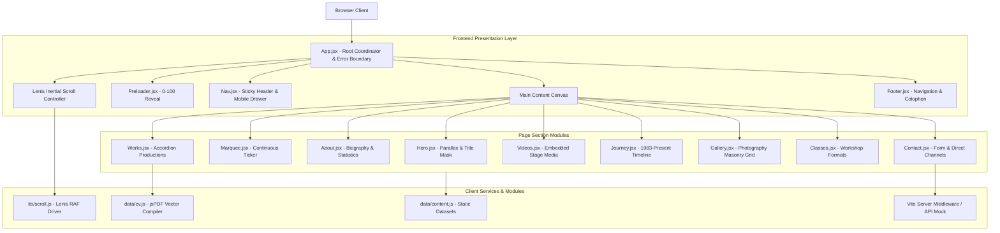

# Functional Specification Document (FSD)
## System: Kalari with Sagar — Portfolio Web Application
**Reference Source**: [https://sagarkalari.co.in/](https://sagarkalari.co.in/)  
**Version**: 1.0.0  
**Status**: Approved & Implemented  
**Date**: November 2026  
**Author**: Antigravity Engineering  
**Schema Alignment**: OpenSpec `spec-driven` Change `clone-sagarkalari-portfolio`

---

## 1. Executive Summary & Objectives

### 1.1 Purpose
This Functional Specification Document (FSD) defines the complete functional requirements, interaction flows, data models, behavior contracts, and visual design rules for the digital portfolio of **Dil Sagar** (`Kalari with Sagar`). The application serves as an interactive archive of over four decades of Kalaripayattu practice, contemporary dance productions, masterclasses, and choreography commissions, while functioning as a primary booking and inquiry channel.

### 1.2 System Objectives
1. **High-Fidelity Replication**: Replicate the UI/UX, responsive layouts, motion choreography, typography, and palette of the reference production site `https://sagarkalari.co.in/`.
2. **Fluid Motion & Aesthetics**: Deliver an earthen, meditative visual atmosphere using deep blacks, warm coal, gold accents, and grain overlays paired with inertial smooth scrolling.
3. **Offline Document Delivery**: Provide a client-side vector PDF generation engine that dynamically compiles and downloads Dil Sagar's complete professional CV.
4. **Lead Capture & Communication**: Enable prospective clients, festival curators, corporate wellness heads, and students to initiate enquiries with real-time feedback and direct access to telephone, email, and WhatsApp channels.

---

## 2. System Architecture & Component Hierarchy

### 2.1 Architecture Diagram



### 2.2 Technology Stack
- **Framework**: React 18 (`react`, `react-dom`)
- **Build Tool**: Vite 6 (`@vitejs/plugin-react`)
- **Styling**: Tailwind CSS v3 with PostCSS and Autoprefixer
- **Motion & Transitions**: Framer Motion v11 (`motion`, `AnimatePresence`, `useScroll`, `useTransform`)
- **Smooth Inertial Scrolling**: Lenis v1 (`@studio-freight/lenis` / `lenis`)
- **PDF Generation**: jsPDF v2 (`jspdf`)
- **Toast Notifications**: Sonner v1 (`sonner`)
- **Data Querying**: TanStack React Query v5 (`@tanstack/react-query`)

---

## 3. User Personas & Use Case Journeys

### 3.1 Primary Personas

1. **Festival Curator / Producer (International & National)**:
   - *Goal*: Review Dil Sagar's past touring productions (*Venice Biennale*, *NCPA Mumbai*, *Purushartha*), verify credentials, review videos, and download his CV for programming boards.
2. **Corporate Wellness Director / HR Lead**:
   - *Goal*: Understand corporate workshop structures, physical conditioning outcomes, duration, and submit a booking inquiry for executive teams.
3. **Contemporary Dance Student / Artiste**:
   - *Goal*: Discover masterclasses, intensive company classes, and movement integration workshops.
4. **Prospective Martial Arts Student / Parent**:
   - *Goal*: Learn about classical Kalaripayattu lineage (Vallabhatta Kalari Sangam), child-friendly training, and direct contact numbers.

---

## 4. Detailed Functional Module Specifications

### 4.1 Module 01: Preloader & Loading State (`Preloader.jsx`)

- **Description**: Displays a modal cover during asset initialization that animates a numeric percentage counter from 0 to 100 before smoothly sliding up to reveal the website.
- **Functional Requirements**:
  - **FR-01.1**: The preloader SHALL cover the entire viewport (`fixed inset-0 z-[120]`) with background `#0C0A08`.
  - **FR-01.2**: The preloader SHALL render the Malayalam script `കളരി` centered in gold (`#C9A15C`) with a font scale animation.
  - **FR-01.3**: The preloader SHALL render subtitle `"Kalari with Sagar"` in uppercase tracking (`tracking-[0.5em]`).
  - **FR-01.4**: A bottom-right counter SHALL increment using random step intervals (1 to 8) every 55ms until reaching 100.
  - **FR-01.5**: On reaching 100, the system SHALL wait 400ms, then trigger `onComplete()`, animating the preloader up (`exit={{ y: "-100%" }}`).
  - **FR-01.6**: While the preloader is mounted, body scrolling SHALL be disabled (`document.body.style.overflow = "hidden"` and `stopScroll()`).

### 4.2 Module 02: Sticky Header & Global Navigation (`Nav.jsx`)

- **Description**: Fixed navigation bar providing smooth scrolling navigation, brand identification, CTA trigger, and a responsive mobile menu.
- **Functional Requirements**:
  - **FR-02.1**: The navbar SHALL fix to the top of the viewport (`fixed inset-x-0 top-0 z-[60]`).
  - **FR-02.2**: The navbar SHALL listen to window scroll position. When `window.scrollY > 40`, it SHALL apply background `#0C0A08/80`, a subtle border `border-bone/10`, and backdrop blur (`backdrop-blur-md`). When `window.scrollY <= 40`, it SHALL remain transparent.
  - **FR-02.3**: Brand Logo button SHALL render the custom diamond SVG mark and text `"Kalari with Sagar"`. Clicking it SHALL scroll smoothly to the `#top` anchor.
  - **FR-02.4**: Desktop nav items (`About`, `Works`, `Journey`, `Gallery`, `Classes`, `Contact`) SHALL trigger Lenis smooth scroll to the target element ID.
  - **FR-02.5**: The CTA button `"Book a workshop"` SHALL scroll directly to `#contact`.
  - **FR-02.6**: On viewports `< 1024px`, desktop links SHALL hide, and a two-line hamburger button SHALL appear.
  - **FR-02.7**: Clicking the hamburger SHALL toggle the fullscreen mobile menu drawer with clip-path transition (`clipPath: inset(0 0 0% 0)`), staggered menu items with leading numbers (`01` to `06`), direct phone links, and mailto link.

### 4.3 Module 03: Hero Section (`Hero.jsx`)

- **Description**: High-impact full-height opening section displaying Dil Sagar's stage movement photography, typographic headline, and scroll cue.
- **Functional Requirements**:
  - **FR-03.1**: The section SHALL occupy full screen height (`h-[100svh] min-h-[640px]`).
  - **FR-03.2**: Parallax background image SHALL transform vertically on scroll from `0%` to `22%` using `useTransform`.
  - **FR-03.3**: Right-hand background SHALL display a giant semi-transparent Malayalam script `കളരി` (`opacity-[0.05] font-mal text-[38vw]`).
  - **FR-03.4**: Tagline SHALL read `"കളരി · Kalari with Sagar — since 1983"`.
  - **FR-03.5**: Main headline SHALL render `"DIL"` on line 1 (solid `#EFE7DA`) and `"SAGAR"` on line 2 (italic with `#C9A15C` outline stroke) using masked line slide-in animations.
  - **FR-03.6**: Primary CTA `"Explore the work"` SHALL scroll to `#works`; secondary CTA `"Book a workshop"` SHALL scroll to `#contact`.
  - **FR-03.7**: Bottom metadata strip SHALL render an animated vertical line scroll cue (`animate-scroll-cue`), core keywords, and `"3× State Champion — 2× National"`.

### 4.4 Module 04: Continuous Marquee Ticker (`Marquee.jsx`)

- **Description**: Continuous looping banner showcasing the core pillars of Sagar's work.
- **Functional Requirements**:
  - **FR-04.1**: Items SHALL cycle horizontally: `"Kalaripayattu"`, `"Contemporary Dance"`, `"Choreography"`, `"Movement Arts"`, `"Self-Defence"`, `"Workshops"`.
  - **FR-04.2**: Items SHALL alternate between bone regular font and gold italic font, separated by terracotta diamond vectors (`#C25E3E`).
  - **FR-04.3**: Animation SHALL run endlessly (`marquee-x 60s linear infinite`).
  - **FR-04.4**: Hovering anywhere within the marquee container SHALL pause the animation (`group-hover:[animation-play-state:paused]`).

### 4.5 Module 05: Biography & Achievements (`About.jsx`)

- **Description**: Detailed profile covering 40+ years of martial arts lineage, UK movement work, and international festival performances.
- **Functional Requirements**:
  - **FR-05.1**: Section header SHALL render section index `"01 — THE PRACTICE"` and display the headline `"A body forged in Kerala's ancient martial art, at home on the world's contemporary stages."`.
  - **FR-05.2**: Left column SHALL render Dil Sagar's portrait photo with a 3:4 aspect ratio, subtle border, photo-grading contrast filter, and a background watermark `"1983"`.
  - **FR-05.3**: Right column SHALL present three narrative paragraphs detailing his training at Vallabhatta Kalari Sangam, his tenure with Imlata Dance Company (London), and Attakkalari Centre for Movement Arts.
  - **FR-05.4**: A 3-column stats grid SHALL render:
    1. `1983` — Training since (Vallabhatta Kalari Sangam, Chavakkad)
    2. `3×` — State champion (Kerala Kalaripayat Association)
    3. `2×` — National champion (Full-contact combat)

### 4.6 Module 06: Selected Works Accordion (`Works.jsx`)

- **Description**: Chronological showcase of choreographic works and international tours with expandable accordion rows.
- **Functional Requirements**:
  - **FR-06.1**: Section header SHALL display `"03 — SELECTED WORKS"`.
  - **FR-06.2**: Header SHALL contain a `"Download CV (PDF)"` button with a download icon that invokes `downloadCV()`.
  - **FR-06.3**: Accordion rows SHALL render production number (`01` to `09`), title in large serif font, producing company, and year.
  - **FR-06.4**: Clicking an item SHALL toggle its expanded state; clicking an already open item SHALL collapse it (`open === w.id ? null : w.id`).
  - **FR-06.5**: Expanded body SHALL display detailed production notes, venue lists (e.g. *Venice Biennale*, *JuliDans*, *Munich*), and production photos if available.
  - **FR-06.6**: Rows SHALL support full keyboard and mouse interaction with ARIA `aria-expanded` attributes.

### 4.7 Module 07: In Motion / Video Showcase (`Videos.jsx`)

- **Description**: Video gallery displaying choreography in action across cinema and stage.
- **Functional Requirements**:
  - **FR-07.1**: Section header SHALL display `"04 — IN MOTION"`.
  - **FR-07.2**: The section SHALL render a responsive 3-column grid containing embedded iframes:
    1. *Chandra — choreographed & trained by Dil Sagar* (2013)
    2. *Chandra — with Shriya Saran* (2013)
    3. *Sougandhya Parvam — a small part* (2017)
  - **FR-07.3**: Each video SHALL render in a 16:9 aspect ratio (`aspect-video`) with lazy loading and full-screen permissions enabled.

### 4.8 Module 08: Chronological Timeline (`Journey.jsx`)

- **Description**: Year-by-year history tracking Dil Sagar's evolution from 1983 to the present.
- **Functional Requirements**:
  - **FR-08.1**: Section header SHALL display `"06 — THE JOURNEY"`.
  - **FR-08.2**: Timeline rows SHALL render with year badges in terracotta (`#C25E3E`), title in serif font, and detailed narrative descriptions.
  - **FR-08.3**: Milestones SHALL include: 1983 Roots, 1988–89 First stages, 1991–94 Championship years, 1990s National champion, 1990–97 London, 2001–09 Attakkalari, 2006–07 Purushartha tours, 2008 Rashtrapati Bhavan, 2009 Ashank, 2011–13 Teaching & screen, 2014 NCPA & Trissur, and 2017–20 Passing it on.

### 4.9 Module 09: Performance Photo Gallery (`Gallery.jsx`)

- **Description**: Visual masonry layout featuring archival performance stills and news clippings.
- **Functional Requirements**:
  - **FR-09.1**: Section header SHALL display `"05 — IN PERFORMANCE"`.
  - **FR-09.2**: Images SHALL render in a CSS multi-column layout (`columns-1 sm:columns-2 lg:columns-3`).
  - **FR-09.3**: Each image item SHALL respect assigned aspect ratios (`aspect-[4/3]`, `aspect-[3/4]`, `aspect-[1/1]`).
  - **FR-09.4**: Default image state SHALL be slightly desaturated (`grayscale-[0.35]`).
  - **FR-09.5**: On cursor hover:
    - Image SHALL scale up smoothly to `1.04` and transition to full color (`grayscale-0`).
    - Gradient dark overlay SHALL fade in (`opacity-100`).
    - Caption bar SHALL slide up from bottom (`translate-y-0`).

### 4.10 Module 10: Classes, Offerings & Masterclasses (`Classes.jsx`)

- **Description**: Information architecture for educational programs, corporate conditioning, and dancer workshops.
- **Functional Requirements**:
  - **FR-10.1**: Section header SHALL display `"07 — CLASSES & WORKSHOPS"`.
  - **FR-10.2**: Format cards (I: Corporates, II: Dance Companies, III: Self-Defence) SHALL render with roman numerals, target audience badges, descriptions, and feature bullet lists with gold diamond bullets.
  - **FR-10.3**: Hovering a card SHALL raise it by 6px (`whileHover={{ y: -6 }}`) and highlight the border to gold.
  - **FR-10.4**: Left panel SHALL display pill tags for all 6 core offerings: *Community classes*, *Kalari for kids (school)*, *Corporate workshops*, *Personal training*, *Company classes*, *Performances & choreography*.
  - **FR-10.5**: Right panel SHALL list all institutions and companies where masterclasses have been conducted (*Shobhana Jeyasingh Dance Company*, *Tribhanga Dance Theatre*, *Infosys*, *CGI*, *STEM Dance Kampni*, etc.).

### 4.11 Module 11: Contact & Enquiry Management (`Contact.jsx`)

- **Description**: Bidirectional inquiry system with field validation and immediate toast feedback.
- **Functional Requirements**:
  - **FR-11.1**: Section header SHALL display `"08 — CONTACT"`.
  - **FR-11.2**: Left panel SHALL display direct telephone link with hover arrow (`↗`), email link, blog link (`kalariwithsagar.blogspot.com`), and WhatsApp direct action button.
  - **FR-11.3**: The form SHALL contain:
    - **Name**: Required text input, minimum 2 characters.
    - **Phone or Email**: Required text input, minimum 5 characters.
    - **Interested in**: Dropdown selector with options: *Community class*, *Kalari for kids*, *Corporate workshop*, *Personal training*, *Company class*, *Performance / choreography*, *Other*.
    - **Message**: Optional 3-row textarea for details.
  - **FR-11.4**: On submit, button SHALL enter sending state (`"Sending…"`) and disable double submission.
  - **FR-11.5**: The client SHALL dispatch a JSON `POST` request to `/api/enquiries`.
  - **FR-11.6**: On `200 OK`, form fields SHALL reset, and a success toast SHALL appear: `"Enquiry received — Sagar will get back to you."` with dark background and gold border.
  - **FR-11.7**: On failure, an error toast SHALL appear: `"Could not send — please call or WhatsApp instead."` with terracotta border.

### 4.12 Module 12: Curriculum Vitae Vector PDF Generator (`cv.js`)

- **Description**: Dynamic vector PDF rendering engine generating an official printable resume.
- **Functional Requirements**:
  - **FR-12.1**: The module SHALL instantiate `new jsPDF({ unit: "mm", format: "a4" })`.
  - **FR-12.2**: The document SHALL apply exact brand hex colors (`ink`, `coal`, `gold`, `terra`, `bone`, `sand`).
  - **FR-12.3**: Top header band SHALL draw a filled dark rectangle with gold underline, large bold artist name `"DIL SAGAR"`, subtitle, and contact details.
  - **FR-12.4**: The engine SHALL format sections: *Profile*, *Championships*, *Professional Experience*, *Significant Performances*, *Masterclasses & Workshops*, and *Training*.
  - **FR-12.5**: The engine SHALL calculate dynamic text heights (`doc.splitTextToSize`) and automatically insert page breaks with recurring header/footer banners when content exceeds page bounds.
  - **FR-12.6**: The generator SHALL trigger file download saved as `dil-sagar-cv.pdf`.

### 4.13 Module 13: Footer (`Footer.jsx`)

- **Description**: Global bottom banner and colophon.
- **Functional Requirements**:
  - **FR-13.1**: SHALL render brand mark and logo scrolling to top on click.
  - **FR-13.2**: SHALL render quick anchor links for all 7 primary sections.
  - **FR-13.3**: SHALL render dynamic year copyright: `© {Current Year} Dil Sagar — Kalari with Sagar`.
  - **FR-13.4**: SHALL display archival credit notice.

---

## 5. Data Contracts & Data Models

### 5.1 Contact & Communication Data Model (`CONTACT`)

```javascript
export const CONTACT = {
  phones: ["+91 97458 56669"],
  phoneLinks: ["tel:+91745856669"],
  email: "dilsagarm@gmail.com",
  whatsapp: "https://wa.me/919745856669",
  blog: "https://kalariwithsagar.blogspot.com/",
  blogLabel: "kalariwithsagar.blogspot.com",
};
```

### 5.2 Enquiry Form Submission Schema

```typescript
interface EnquiryPayload {
  name: string;        // Min length: 2 characters
  contact: string;     // Phone number or email string, min length: 5
  interest: string;    // One of INTERESTS enum values
  message?: string;    // Optional notes, group size, dates
}

interface EnquiryResponse {
  status: "ok" | "error";
  message: string;
  detail?: string;
}
```

### 5.3 Selected Works Data Schema

```typescript
interface WorkItem {
  id: string;          // Kebab-case identifier (e.g. "beyond-the-walls")
  title: string;       // Production name
  year: string;        // Year or year span (e.g. "2006–07")
  company: string;     // Producing ensemble or company
  venues: string;      // Dot-separated touring venues & festivals
  note: string;        // Critical description and context
  image?: string;      // Optional archival stage photograph URL
}
```

---

## 6. Design System, Color Tokens & Typography Specifications

### 6.1 Color Matrix

| Token Name | Hex Code | RGB | Role / Usage |
|:---|:---|:---|:---|
| **`ink`** | `#0C0A08` | `rgb(12, 10, 8)` | Primary application background, high-contrast canvas |
| **`coal`** | `#161109` | `rgb(22, 17, 9)` | Card backgrounds, preloader, marquee strip |
| **`gold`** | `#C9A15C` | `rgb(201, 161, 92)` | Primary accent, section indicators, active text, borders |
| **`gild`** | `#E4C287` | `rgb(228, 194, 135)` | Primary button hover highlight |
| **`terra`** | `#C25E3E` | `rgb(194, 94, 62)` | Terracotta year marks, diamond separators, error toasts |
| **`bone`** | `#EFE7DA` | `rgb(239, 231, 218)` | Primary heading and high-emphasis typography |
| **`sand`** | `#A6937B` | `rgb(166, 147, 123)` | Secondary body typography, meta labels, descriptions |

### 6.2 Typography Hierarchy

| Font Family | CSS Utility | Target Elements | Sizing Spectrum |
|:---|:---|:---|:---|
| **Fraunces** | `font-serif` | Hero headline, section titles, accordion titles | `text-2xl` to `text-[13.5rem]` |
| **Instrument Sans**| `font-sans` | Body copy, accordion descriptions, bio | `text-sm` to `text-base` |
| **Fragment Mono** | `font-mono` | Section index (`01`), dates, pills, badges | `text-[10px]` to `text-xs` |
| **Noto Sans Mal.** | `font-mal` | Cultural watermark (`കളരി`), preloader | `text-7xl` to `text-[38vw]` |

### 6.3 Motion & Interaction Curves
- **Standard Smooth Easing**: `cubic-bezier(0.22, 1, 0.36, 1)` (`EASE`)
- **Preloader Exit Curtain Easing**: `cubic-bezier(0.76, 0, 0.24, 1)`
- **Scroll Cue Cycle Duration**: `2.2s` with `cubic-bezier(0.65, 0, 0.35, 1)`
- **Lenis Inertial Smoothing**: `lerp: 0.085`, `smoothWheel: true`

---

## 7. Responsive Breakpoint & Viewport Behavior

| Viewport Range | Breakpoint | Adaptations & Behavior |
|:---|:---|:---|
| **Mobile** (< 640px) | `default` | Single column grid; navbar shows hamburger only; full-screen mobile menu drawer; typography clamps to `text-4xl` - `text-5xl`. |
| **Tablet** (640px – 1024px) | `sm:` / `md:` | Two-column gallery; 3-column stats grid; full button labels; tablet padding (`px-10`). |
| **Desktop** (> 1024px) | `lg:` / `xl:` | Full horizontal navbar; 3-column classes grid; 3-column video grid; 1983 background watermark appears in About; max content width `1600px`. |

---

## 8. Verification & Acceptance Criteria

1. **Pixel-Perfect Visual Consistency**:
   - Layout, typography, spacing, and colors match `https://sagarkalari.co.in/` across all 9 primary sections.
2. **Animation & Transition Execution**:
   - Preloader counter counts up smoothly and unveils the Hero section without layout shifts.
   - Hero headline masked lines slide into place with zero jitter.
   - Marquee loops endlessly without seam gaps and pauses on hover.
3. **Accordion & Interaction Behavior**:
   - Accordion rows expand and collapse with fluid height animation.
   - "Download CV (PDF)" initiates browser download of `dil-sagar-cv.pdf` with properly formatted vector layouts.
4. **Form Validation & Submission**:
   - Empty or invalid name/contact triggers HTML5 validation.
   - Successful submission delivers `POST /api/enquiries`, resets form fields, and renders custom dark/gold Sonner toast.
5. **Cross-Platform Responsiveness**:
   - Mobile hamburger menu toggles fullscreen navigation drawer.
   - Inertial scroll operates smoothly with no horizontal overflow (`overflow-x: hidden`).
